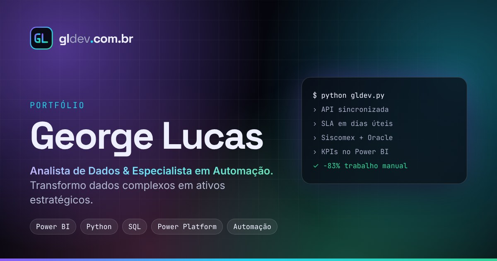
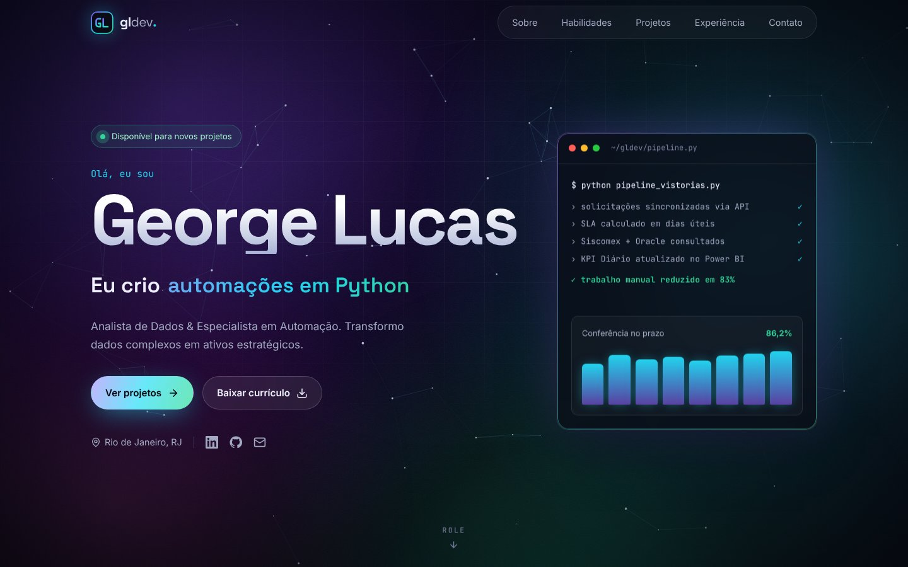
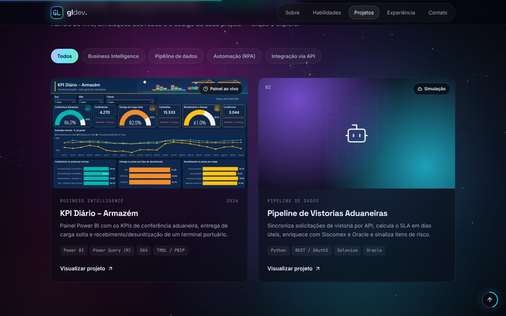
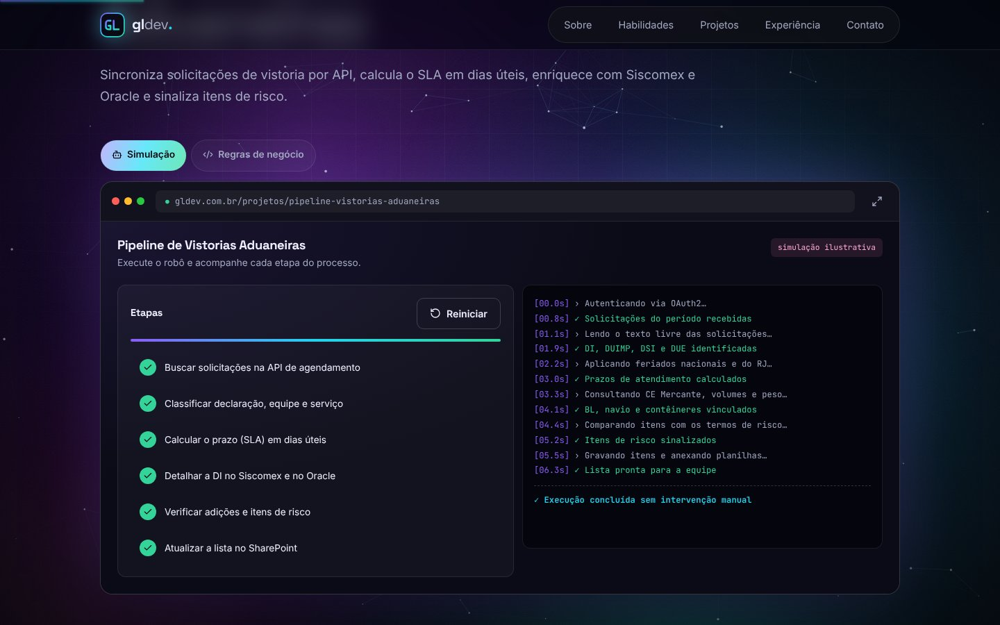
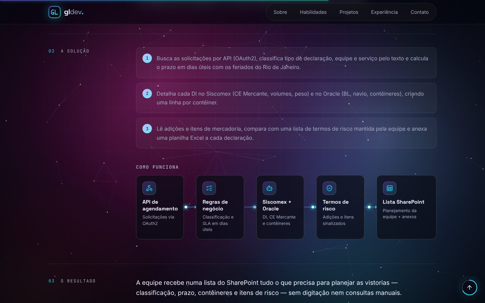
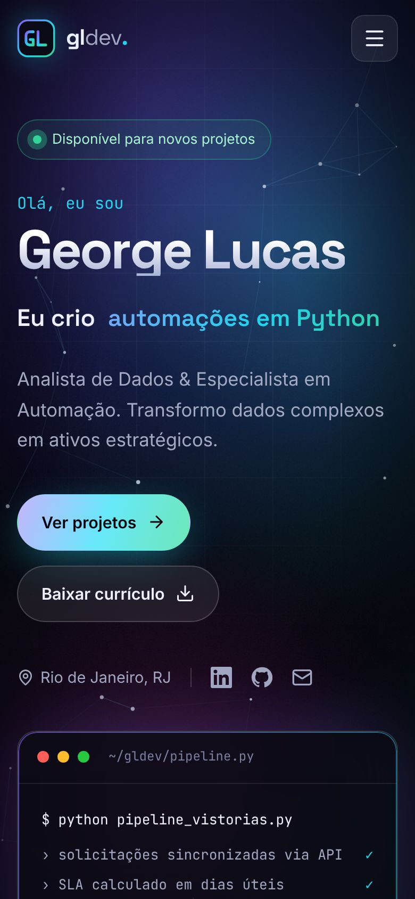

<div align="center">



# gldev — Portfólio de George Lucas

**Dados · BI · Automação**

[**🌐 gldev.com.br**](https://gldev.com.br) · [LinkedIn](https://www.linkedin.com/in/george-lucas-b96141182/) · [GitHub do George](https://github.com/glucas290)


</div>

---

Portfólio de **George Lucas**, analista de dados e especialista em automação. Cada projeto tem uma página própria em que quem visita pode **testar e visualizar o trabalho**: painel do Power BI ao vivo, robôs executando passo a passo, estudo de caso com diagrama animado e o código-fonte real.

Os projetos vêm do repositório [glucas290/GLdev](https://github.com/glucas290/GLdev).

<div align="center">
  
</div>

## ✨ Destaques

- **Fundo vivo:** auroras coloridas animadas pela placa de vídeo e uma constelação de pontos que reage ao mouse. As cores mudam conforme a rolagem.
- **Conteúdo que aparece com o scroll:** blocos surgem com desfoque, as palavras do "Sobre" acendem uma a uma, a linha do tempo se preenche e os números contam até o valor.
- **Projetos para testar, não só para ler:** cada projeto abre em abas dentro de uma "janela de navegador":
  - **Power BI ao vivo** (publicado na web) e capturas de tela
  - **Simulação dos robôs**: etapas executando com log em tempo real
  - **Código real** com destaque de sintaxe (Python, SQL, DAX e Power Query M)
- **Estudo de caso:** problema → solução → resultado, com diagrama "Como funciona" em que os dados percorrem o fluxo.
- **Prévia bonita ao compartilhar:** o site e cada projeto têm imagem e textos próprios no LinkedIn, no WhatsApp e no Google.
- **Para qualquer pessoa:** todos os textos ficam em uma pasta só, com guia em português para quem não programa.

<table>
  <tr>
    <td width="50%"></td>
    <td width="50%"></td>
  </tr>
  <tr>
    <td align="center"><sub>Projetos com filtro por categoria</sub></td>
    <td align="center"><sub>Simulação passo a passo de um robô</sub></td>
  </tr>
  <tr>
    <td width="50%"></td>
    <td width="50%" align="center"></td>
  </tr>
  <tr>
    <td align="center"><sub>Estudo de caso com diagrama animado</sub></td>
    <td align="center"><sub>Versão para celular</sub></td>
  </tr>
</table>

## 📊 Qualidade

Medido com o Lighthouse na versão de produção:

| Página | Desempenho (celular) | Desempenho (computador) | Acessibilidade | Boas práticas | SEO |
| --- | :---: | :---: | :---: | :---: | :---: |
| Início | 92 | 100 | 100 | 100 | 100 |
| Página de projeto | 92 | 100 | 100 | 100 | 100 |

- **Acessibilidade:** auditoria axe-core (WCAG 2.1 AA) sem violações; link "Pular para o conteúdo", foco visível, contraste AA, botão de voltar ao topo e respeito à opção de reduzir animações.
- **SEO:** metatags e imagem de prévia por projeto, `sitemap.xml`, `robots.txt` e dados estruturados `schema.org/Person`.
- **Desempenho:** páginas carregadas sob demanda, imagens em WebP, fontes pré-carregadas e animações leves no celular.

## 📁 Projetos em destaque

| Projeto | Categoria | O que dá para ver no site |
| --- | --- | --- |
| KPI Diário – Armazém | Business Intelligence | Painel Power BI ao vivo, capturas, medidas DAX e Power Query |
| Pipeline de Vistorias Aduaneiras | Pipeline de dados | Simulação do robô e regras de negócio em Python |
| Monitor de DTA – Gate-in e Integridade | Automação (RPA) | Simulação e o robô do Siscomex |
| Consulta de Perdimento – Siscarga/Siscomex | Automação (RPA) | Simulação e a orquestração |
| Consulta de DUIMP – Portal Único | Integração via API | Simulação e o cliente da API com certificado digital |
| Monitor de Programação de Navios | Automação (RPA) | Simulação e o script completo |

## ✏️ Quero só mudar textos, projetos ou fotos

Você **não precisa entender de programação**. Todo o conteúdo do site fica em uma única pasta:

```
src/conteudo/
├── perfil.ts         → nome, cargo, resumo, números de destaque, contatos
├── habilidades.ts    → cartões da seção "Habilidades"
├── projetos.ts       → projetos, estudos de caso e formas de visualização
├── experiencias.ts   → linha do tempo profissional
├── formacao.ts       → formação acadêmica e certificações
└── site.ts           → endereço do site e textos para o Google
```

O passo a passo completo está em **[docs/COMO-EDITAR.md](docs/COMO-EDITAR.md)**.

## 🚀 Rodando no computador

Pré-requisito: [Node.js](https://nodejs.org) 20 ou mais recente.

```bash
npm install
```

```bash
npm run dev
```

Abra o endereço que aparecer no terminal (normalmente http://localhost:5173).

| Comando | O que faz |
| --- | --- |
| `npm run dev` | Abre o site em modo de desenvolvimento |
| `npm run build` | Verifica o código e gera a versão final em `dist/` |
| `npm run preview` | Mostra localmente a versão final gerada |
| `npm run imagens` | Gera de novo as imagens de prévia dos links |

## 🗂️ Organização das pastas

```
├── docs/                    Guias (editar, publicar, design) e imagens do README
├── plugins/                 Gera no build as prévias de cada projeto e o sitemap.xml
├── scripts/                 Gerador das imagens de prévia (npm run imagens)
├── public/                  Arquivos servidos como estão
│   ├── documentos/          Currículo em PDF
│   ├── og/                  Imagens de prévia dos links (LinkedIn, WhatsApp…)
│   ├── projetos/            Imagens e arquivos de código de cada projeto
│   ├── robots.txt           Instruções para buscadores
│   └── favicon.svg          Ícone da aba do navegador
└── src/
    ├── conteudo/            ✏️ TEXTOS DO SITE — edite aqui
    ├── tipos/               Formato de cada informação do conteúdo
    ├── paginas/             Páginas: inicial, projeto e "não encontrada"
    ├── secoes/              Blocos da página inicial (Abertura, Sobre, Projetos…)
    ├── componentes/
    │   ├── estrutura/       Menu, rodapé, barra de progresso, voltar ao topo e pular conteúdo
    │   ├── fundo/           Fundo animado (auroras + constelação)
    │   ├── interface/       Peças reutilizáveis: logo, botões, animações
    │   └── projetos/        Cartão, visualizador com abas, simulação, leitor de código e diagrama
    ├── ganchos/             Comportamentos reutilizáveis (React hooks)
    ├── utilitarios/         Funções auxiliares
    ├── estilos/             Cores, fontes e estilos globais
    ├── App.tsx              Rotas do site
    └── main.tsx             Ponto de entrada
```

Cada componente fica em sua própria pasta, com o código (`.tsx`) e o estilo (`.module.css`) lado a lado.

## 🌐 Publicação

O site é publicado na Vercel automaticamente a cada alteração na `main`. Para ligar ou trocar o domínio, veja **[docs/PUBLICACAO.md](docs/PUBLICACAO.md)**. O guia visual está em **[docs/DESIGN.md](docs/DESIGN.md)**.

## 🛠️ Tecnologias

React · TypeScript · Vite · Framer Motion · React Router · CSS Modules · Lucide Icons · Playwright (imagens de prévia)

## 📄 Licença

© 2026 Ryan G. Santos. Todos os direitos reservados. O código está público apenas para portfólio e avaliação: não é permitido copiar, modificar, distribuir ou usar comercialmente sem autorização por escrito. Veja o arquivo [LICENSE](LICENSE).
